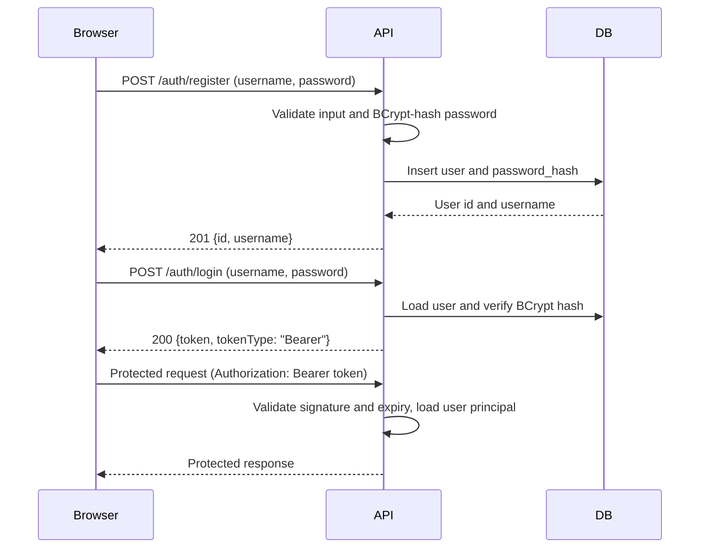

# Authentication flow

The browser keeps the token in local storage and sends it in the `Authorization` header. Invalid or expired tokens are rejected. The planned STOMP connection will carry the token in its `CONNECT` headers; token validation for STOMP is a later chat milestone.
